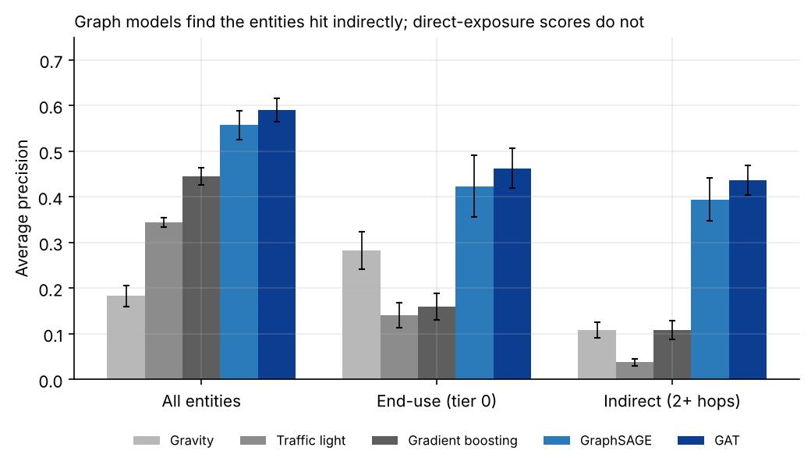
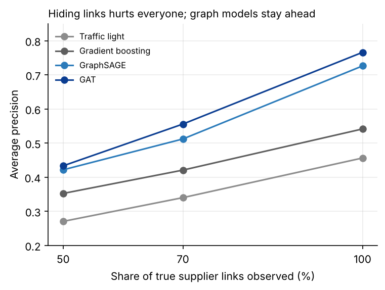
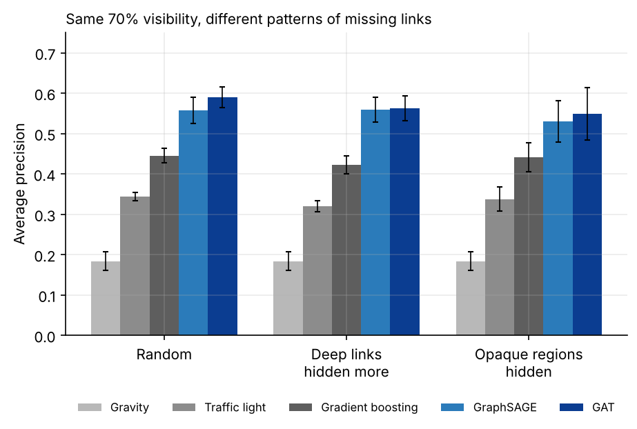
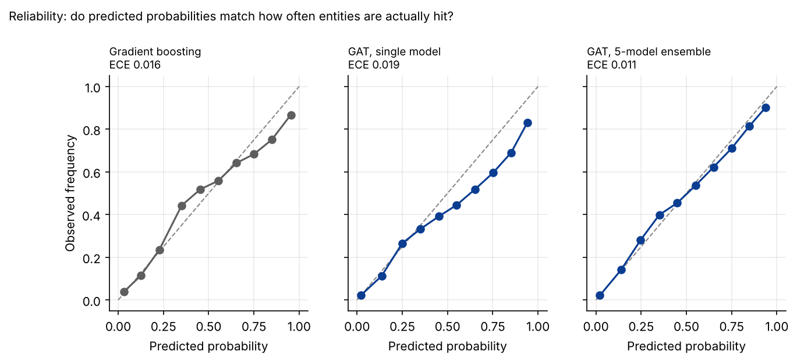
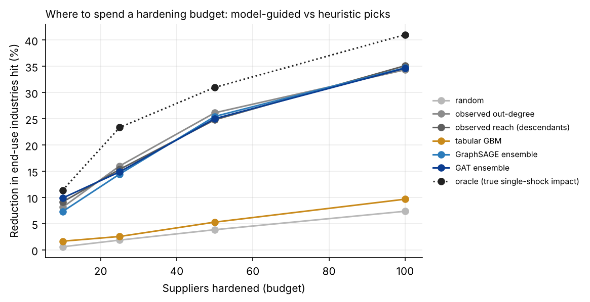

# Supply Chain Cascade Testbed: Graph Neural Networks vs. Direct-Exposure Baselines

A synthetic experiment that asks one question: **when a shock hits a multi-tier supply network, can a graph neural network predict which entities lose capacity, including entities several tiers downstream, better than scoring approaches that only look at direct exposure?**

Everything here is synthetic. There is no real trade, company, or government data. The results show that the approach can learn cascade structure and generalize to an unseen network. They do not show how well it would perform on real supply chains.

## Findings at a glance

1. **Graph models find indirect damage that direct-exposure scores miss.** On entities two or more hops from the shock, GAT reaches average precision of 0.44, against 0.04 for a direct-exposure "traffic light" score and 0.11 for gradient boosting on one-hop features.
2. **The advantage survives realistic missing data.** Hiding links preferentially at deep tiers, or in a few opaque regions, costs the graph models at most 0.04 AP overall. They stay roughly 0.1 AP or more ahead of the best non-graph model. Indirect-effect AP falls the most when whole regions are opaque (0.44 to 0.37).
3. **Ensembling gives better and better-calibrated probabilities.** A 5-model GAT ensemble improves AP (0.58 to 0.60) and expected calibration error (0.020 to 0.012) over a single model. Most models were already reasonably calibrated.
4. **For deciding where to harden, simple heuristics are as good as the GNNs.** A plain count of downstream reach captures 66% to 86% of the benefit of an oracle ranking, and the GNN ensembles match it rather than beat it. A model that only sees one-hop information barely beats random. Multi-hop structure matters; learning on top of it did not add much for this decision.



## Why this exists

Tracing how a disruption propagates through nth-tier supplier dependencies is hard because the effects are indirect, delayed, and hidden by incomplete knowledge of who supplies whom. Simple scoring methods look at direct suppliers or at aggregate size. This testbed gives a controlled setting, with known ground truth, to compare those methods against graph learning.

## Base results

Trained on 360 shock scenarios from one network and tested on 120 scenarios from a **different network the models never saw**, with 70% of the true supply links observed. Mean ± standard deviation over 3 seeds. AP is average precision. Random guessing scores 0.07 on AP overall and 0.04 on indirect effects.

| Model | AP, all entities | AP, end-use industries (tier 0) | AP, 2+ hops from shock | AUROC |
| --- | --- | --- | --- | --- |
| Gravity (size-based) | 0.18 ± 0.02 | 0.28 ± 0.04 | 0.11 ± 0.02 | 0.75 ± 0.02 |
| Traffic light (direct suppliers) | 0.34 ± 0.01 | 0.14 ± 0.03 | 0.04 ± 0.01 | 0.68 ± 0.01 |
| Gradient boosting (1-hop features) | 0.45 ± 0.02 | 0.16 ± 0.03 | 0.11 ± 0.02 | 0.84 ± 0.00 |
| GraphSAGE | 0.56 ± 0.03 | 0.42 ± 0.07 | 0.39 ± 0.05 | 0.89 ± 0.01 |
| Graph attention (GAT) | 0.59 ± 0.03 | 0.46 ± 0.04 | 0.44 ± 0.03 | 0.90 ± 0.00 |

**Hidden links.** The models see only the observed part of the network. Average precision as the share of observed links changes (one seed):

| Model | 50% observed | 70% observed | 100% observed |
| --- | --- | --- | --- |
| Traffic light | 0.27 | 0.34 | 0.46 |
| Gradient boosting | 0.35 | 0.42 | 0.54 |
| GraphSAGE | 0.42 | 0.51 | 0.73 |
| Graph attention | 0.43 | 0.56 | 0.77 |

Every model degrades as links are hidden. The graph models stay ahead at every level, and the gap narrows at 50% but does not close.



**Single points of failure.** For 150 upstream suppliers per seed, the true downstream impact was computed by simulation, and each method ranked the suppliers. This is a negative result worth reporting:

| Ranking method | Spearman with true impact | Top-10 overlap (of 10) |
| --- | --- | --- |
| Observed reach (count of descendants) | 0.86 | 8.0 |
| Observed out-degree | 0.86 | 7.3 |
| GraphSAGE | 0.85 | 9.0 |
| Graph attention | 0.85 | 8.7 |
| Gradient boosting | 0.85 | 7.3 |
| Size x out-degree (gravity-style) | 0.84 | 6.0 |

All methods land within 0.02 on rank correlation, so network structure does most of the work for this question. A plain reachability count is a strong baseline. The graph models have a small edge on top-10 overlap, which is modest over three seeds. The learned models earn their keep on the other task, predicting which specific entities are hit under a given shock, especially indirect ones.

Also note that GAT's lead over GraphSAGE is small, within what tuning could change. Treat the two as comparable.

## Stress tests

These experiments (`run_extensions.py`) address the main weaknesses of the base study. All use the same training and test protocol, 3 seeds, and 70% of links observed on average.

### Missing links that are not random

Real supply-chain data is not missing at random: sub-tier relationships are far less visible than tier-1 ones, and some regions are opaque. Two patterns were added, each rescaled so the average visibility is still 70%:

- **Deep links hidden more:** visibility falls with the buyer's tier.
- **Opaque regions:** links whose supplier is in one of three randomly chosen regions are mostly hidden.

| AP, all entities | Gravity | Traffic light | Gradient boosting | GraphSAGE | GAT |
| --- | --- | --- | --- | --- | --- |
| Random hiding (base) | 0.18 ± 0.02 | 0.34 ± 0.01 | 0.45 ± 0.02 | 0.56 ± 0.03 | 0.59 ± 0.03 |
| Deep links hidden more | 0.18 ± 0.02 | 0.32 ± 0.01 | 0.42 ± 0.02 | 0.56 ± 0.03 | 0.56 ± 0.03 |
| Opaque regions | 0.18 ± 0.02 | 0.34 ± 0.03 | 0.44 ± 0.04 | 0.53 ± 0.05 | 0.55 ± 0.06 |

| AP, 2+ hops from shock | Gradient boosting | GraphSAGE | GAT |
| --- | --- | --- | --- |
| Random hiding (base) | 0.11 ± 0.02 | 0.39 ± 0.05 | 0.44 ± 0.03 |
| Deep links hidden more | 0.11 ± 0.02 | 0.44 ± 0.04 | 0.44 ± 0.03 |
| Opaque regions | 0.11 ± 0.02 | 0.35 ± 0.05 | 0.37 ± 0.07 |

The graph models' lead holds under both patterns. The opaque-region case is the hardest, with larger variance across seeds, and it hurts indirect predictions the most.



### Richer node features

Adding observed in-degree and out-degree and a noisy reading of each firm's inventory cover (true buffer plus measurement noise) changed little: GraphSAGE 0.56 to 0.59, GAT 0.59 to 0.58, gradient boosting unchanged at 0.45. All of those differences are within the seed-to-seed spread. In this simulator, network structure already carries most of the signal.

### Calibration and ensembles

For decision use, a score is more useful when it behaves like a probability. Each GNN type was trained 5 times with different seeds and the predictions averaged. Brier score and expected calibration error (ECE, 10 bins) are computed over all non-shocked entities in the test scenarios. Mean ± standard deviation over 3 seeds:

| Model | AP | AUROC | Brier | ECE |
| --- | --- | --- | --- | --- |
| Gradient boosting | 0.445 ± 0.019 | 0.844 ± 0.003 | 0.0496 ± 0.0069 | 0.016 ± 0.004 |
| GraphSAGE, single | 0.556 ± 0.038 | 0.886 ± 0.012 | 0.0436 ± 0.0044 | 0.018 ± 0.004 |
| GraphSAGE, 5-model ensemble | 0.592 ± 0.029 | 0.899 ± 0.007 | 0.0413 ± 0.0045 | 0.016 ± 0.005 |
| GAT, single | 0.583 ± 0.020 | 0.902 ± 0.002 | 0.0423 ± 0.0052 | 0.020 ± 0.004 |
| GAT, 5-model ensemble | 0.599 ± 0.028 | 0.905 ± 0.004 | 0.0404 ± 0.0051 | 0.012 ± 0.005 |

Ensembling improves ranking quality and Brier score for both GNN types. Every model is already fairly well calibrated, so the ECE changes are small and within seed noise. The single GAT slightly over-predicts at high probabilities, and the ensemble corrects that (see the plot). I did not find a trustworthy way to turn ensemble disagreement into an error flag in this setup, so no uncertainty-flagging claim is made here.



### From prediction to decision

A supply-chain risk team has a limited budget to harden suppliers (dual-sourcing, safety stock). This experiment asks whether model-based criticality scores pick better targets than simple heuristics.

- **Setup.** In the unseen test network, 600 upstream suppliers (tiers 2 to 4) are candidates. Each method ranks them, and the top *k* are "hardened": 80% of any shock they receive is absorbed. Then 100 fresh shock scenarios are replayed through the true cascade.
- **Metric.** Percentage reduction in the expected number of end-use (tier 0) industries losing at least 25% of capacity. With no hardening, 17.1 of 120 are hit per scenario on average.
- **Scores.** For the model-based methods, a supplier's criticality is the total predicted probability of end-use industries being hit when that supplier alone fails. Heuristics use the observed network only. The oracle uses the true simulated single-supplier impact, which cannot be known in practice.

Reduction in end-use industries hit (%), mean ± standard deviation over 3 seeds:

| Method | k = 10 | k = 25 | k = 50 | k = 100 |
| --- | --- | --- | --- | --- |
| Oracle (true single-shock impact) | 11.4 ± 2.5 | 23.4 ± 1.9 | 31.0 ± 2.7 | 41.0 ± 4.8 |
| Observed reach (descendants) | 9.2 ± 2.1 | 15.4 ± 3.3 | 24.8 ± 3.0 | 35.1 ± 3.2 |
| Observed out-degree | 8.1 ± 2.1 | 16.0 ± 2.3 | 26.2 ± 2.7 | 34.3 ± 3.3 |
| Size x out-degree | 8.2 ± 3.2 | 16.2 ± 1.8 | 25.7 ± 1.7 | 33.9 ± 3.1 |
| GAT ensemble | 9.9 ± 5.6 | 14.9 ± 5.3 | 25.0 ± 4.2 | 34.7 ± 6.4 |
| GraphSAGE ensemble | 7.3 ± 2.9 | 14.5 ± 5.5 | 25.5 ± 6.0 | 34.7 ± 5.7 |
| Gradient boosting (1-hop features) | 1.7 ± 0.4 | 2.6 ± 0.2 | 5.3 ± 1.9 | 9.7 ± 1.9 |
| Random | 0.6 ± 0.2 | 1.9 ± 0.4 | 3.9 ± 0.2 | 7.4 ± 0.5 |



**Reading.** Heuristics that use the multi-hop structure of the observed network and the GNN ensembles are statistically tied, and all of them leave a clear gap to the oracle. The gradient-boosting model, which sees only one-hop information, is barely better than random: where the damage goes depends on multi-hop structure. For this particular decision, the learned models did not beat a reachability count, which is the same conclusion as the single-point-of-failure ranking above. This is a ranking-and-budget heuristic, not a trained policy.

## How the simulator works

`scsim.py` builds a five-tier network of 1,500 entities (tier 0 is end-use industries, tier 4 is raw and upstream inputs) with 6 sectors and 8 regions.

- **Structure.** Each entity needs inputs from 1 to 3 categories. Suppliers are chosen by preferential attachment to large suppliers, which creates hubs and single points of failure. Many inputs are single-sourced. Upstream tiers are regionally concentrated.
- **Shocks.** Four types: one large upstream supplier, a regional event, a regional event within one sector, and several simultaneous supplier failures.
- **Cascade.** A Leontief-style bottleneck: an entity's output is limited by its scarcest input category. Within a category, suppliers can substitute for each other. An inventory buffer absorbs part of any shortfall. Losses propagate downstream through the true network.
- **Partial observation.** The models see only a subset of the true links (default 70%, hidden at random). Two non-random patterns are also available (`hide_mode='tier'` and `'region'`), which stand in for opaque real-world topology.
- **Label.** An entity is positive if it loses at least 25% of capacity and was not directly shocked.

## Models compared

| Model | What it sees |
| --- | --- |
| Gravity | Entity size and shock severity, ignoring network structure |
| Traffic light | Direct (one-hop) supplier exposure |
| Gradient boosting | Tabular features, including one-hop neighborhood features (scikit-learn `HistGradientBoostingClassifier`) |
| GraphSAGE | Four layers, 64 hidden units, residual connections, layer normalization (PyTorch Geometric) |
| Graph attention (GAT) | Same architecture with attention-based aggregation |

All models are evaluated with average precision and AUROC. Average precision is the main metric because only about 7% of entities are positive.

## Reproduce

Python 3.10 or newer. A CPU is enough.

```bash
python -m venv .venv
source .venv/bin/activate        # Windows: .venv\Scripts\activate
pip install -r requirements.txt

# 0. Simulator tests (seconds)
pytest tests

# 1. Quick smoke test (about 30 seconds): small data, few epochs
python models.py quick

# 2. Base experiment (about 20 minutes on 2 CPU threads): 3 seeds at 70% observed,
#    plus 50% and 100% observed for seed 0. Writes results.json
python run_experiments.py
python summarize.py

# 3. Stress tests, calibration and decision layer (about 1.5 hours on 2 CPU threads).
#    Writes results_extensions.json. Run one part with: hidden | features | calib
python run_extensions.py all
python summarize_extensions.py

# 4. Rebuild the figures in figures/
python make_figures.py
```

`results.json` and `results_extensions.json` in this repo are the outputs of the full runs that produced the tables above. A fresh run of the base experiment reproduced the seed-0 numbers in `results.json` exactly (checked to four decimals for all five models).

Tested with Python 3.13, PyTorch 2.14, PyTorch Geometric 2.8, scikit-learn 1.9, NumPy 2.5, SciPy 1.18. If PyTorch Geometric fails to install, see its [installation guide](https://pytorch-geometric.readthedocs.io/en/latest/install/installation.html).

## Files

| File | Purpose |
| --- | --- |
| `scsim.py` | Network generator (with random and non-random link hiding), shock sampler, and cascade simulator |
| `models.py` | Baseline scores, GNN models, training, and evaluation (`quick` and `one` modes) |
| `run_experiments.py` | Base experiment runner, including the single-point-of-failure ranking |
| `run_extensions.py` | Non-random hiding, richer features, ensembles and calibration, decision layer |
| `summarize.py`, `summarize_extensions.py` | Aggregate results across seeds |
| `make_figures.py` | Builds the figures in `figures/` |
| `tests/test_simulator.py` | Simulator invariants: no shock means no loss, losses stay downstream, monotonicity, reproducibility, hiding modes |
| `results.json`, `results_extensions.json` | Raw results from the full runs |

## Limitations

- **The simulator defines the cascade.** The models learn the simulator's rules. The results show feasibility and relative comparisons, not real-world accuracy. This is the main limitation and none of the experiments here remove it.
- **Small scale.** 1,500 entities and 3 seeds. Standard deviations are reported, but the single-point-of-failure comparison, the GAT versus GraphSAGE gap, the GNN-versus-heuristic comparison in the decision experiment, and the calibration differences are within noise.
- **Missing links.** Random hiding was the original assumption. Two non-random patterns are now tested, but both are still simulated patterns, not observed ones.
- **Features.** Adding degree and a noisy inventory signal did not help. More realistic attributes (financial data, lead times, contract terms) were not tested.
- **Uncertainty.** Ensembles give better-calibrated probabilities, but I did not establish a reliable way to flag individual predictions as unreliable.
- **Decision layer.** It ranks suppliers and spends a fixed hardening budget. It is not a trained policy, and the hardening effect (80% shock absorption) is an assumption.

## Possible extensions

- Link prediction for hidden edges, trained jointly with the cascade model.
- Combining the learned model with a structural or symbolic layer so predictions respect known constraints and can be explained along specific supply paths.
- A trained policy (for example reinforcement learning) that chooses buffer or sourcing actions in the simulator, with the reachability heuristic above as the baseline it must beat.
- Uncertainty that identifies individual unreliable predictions (conformal prediction, for example).
- Validation on a real or semi-real network.

## Development note

This code was developed with AI assistance (Claude). I specified the design, experiments, and evaluation, and reviewed the results.

## License

MIT. See `LICENSE`.
